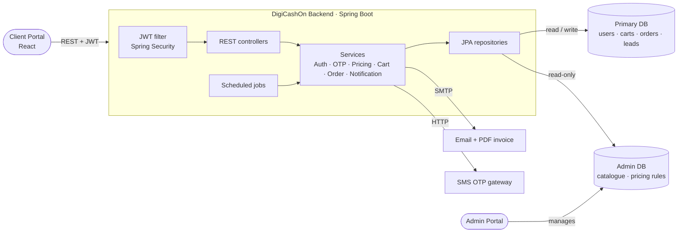
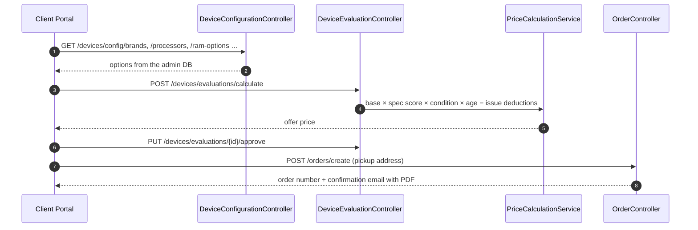

# DigiCashOn – Backend Service (Spring Boot)

The REST backend for **DigiCashOn**, a platform where customers **sell used devices** for an instant price quote and **book laptop and mobile repair services**. It powers the DigiCashOn Client Portal (React) and reads catalogue and pricing data managed in the DigiCashOn Admin Portal.

The service is built with **Java 17** and **Spring Boot 3**. It provides JWT + OTP authentication, a rules-based device pricing engine, cart and order management, email notifications with PDF invoices, and a **two-database architecture**.


> **Note:** the latest code is on the [`dev`](../../tree/dev) branch. This README describes the full feature set there.

---

## Highlights

- **Two datasources**: a *primary* read/write database for customers, carts and orders, and a separate **read-only admin database** for the catalogue and pricing rules that the Admin Portal owns. Each has its own `EntityManagerFactory` and transaction manager.
- **Device pricing engine** (`PriceCalculationService`): the final offer starts from the model's base price, scales it by a spec score for the chosen configuration, then applies a condition multiplier and age depreciation, and subtracts functional-issue deductions, all loaded from the admin database.
- **Authentication**: JWT access and refresh tokens, password login *or* mobile **OTP** login, a 3-step OTP sign-up, forgot and reset password, and email change verified by OTP
- **Role-based access**: `CUSTOMER`, `TECHNICIAN` and `ADMIN` roles, enforced with Spring Security and `@PreAuthorize`
- **Order lifecycle**: create orders from the cart or a device evaluation, then status changes, technician assignment, scheduling, cancellation, search and pagination
- **Notifications**: HTML order-confirmation emails with **PDF invoices** generated with OpenPDF, and SMS OTP through an external SMS gateway
- **Lead capture**: unfinished device evaluations are stored as *temp leads* so the business can follow up
- **Housekeeping jobs**: `@Scheduled` tasks clean up expired carts and OTPs
- **API documentation**: springdoc OpenAPI with Swagger UI, and a global exception handler for consistent error responses

---

## Architecture



### Device sell flow



---

## Tech stack

| Concern         | Technology |
|-----------------|------------|
| Language        | Java 17 |
| Framework       | Spring Boot 3.2 (Web, Data JPA, Security, Validation, Mail) |
| Security        | Spring Security, JJWT (access + refresh tokens), BCrypt, OTP |
| Persistence     | MySQL 8, Hibernate / JPA, two datasources, Flyway (optional) |
| Documents       | OpenPDF (invoice PDFs) |
| Mapping         | ModelMapper, Lombok |
| API docs        | springdoc-openapi, Swagger UI |
| Testing         | JUnit 5, Spring Boot Test, Spring Security Test |
| Build           | Maven (wrapper included) |

---

## Project structure

```
src/main/java/com/repairapp
├── config        # Security, two datasources (Primary + Admin), OpenAPI, JPA auditing
├── security      # JwtAuthenticationFilter, JwtUtils, UserPrincipal
├── controller    # Auth, OTP, User, Address, Cart, Order, Device config/evaluation, Leads
├── service       # Business logic (+ impl): pricing, OTP, notifications, scheduled jobs
├── entity        # Users, addresses, carts, orders, evaluations, OTPs, leads
├── repository    # Spring Data JPA (primary DB)
├── adminread     # Read-only entities & repositories for the admin catalogue DB
├── dto           # Request/response DTOs grouped by domain
├── exception     # GlobalExceptionHandler + custom exceptions
└── util          # Order number generator, schema checks

src/main/java/com/digicashon/digicashonbackendservice
└── …             # Service categories & service cart module
```

---

## API overview

The base path is `/api`. Interactive docs are available at **`/api/swagger-ui.html`** once the app is running.

| Area | Base path | Main operations |
|------|-----------|-----------------|
| Authentication | `/auth` | password & OTP login, 3-step sign-up, refresh token, forgot/reset/change password, `me`, logout |
| OTP | `/otp` | generate / verify / resend (sign-up, password reset, order confirmation) |
| User profile | `/users` | profile details, change email (OTP), payment methods, technicians list |
| Addresses | `/profile/addresses` | CRUD, set default |
| Device catalogue | `/devices/config` | super-categories, brands, models, processors, RAM, storage, graphics, screen sizes, conditions, age options, functional issues |
| Device evaluation | `/devices/evaluations` | calculate price, approve / reject / recalculate, user history |
| Leads | `/devices/temp-leads` | save and list unfinished evaluations |
| Repair services | `/services` | search, filter, price range, featured, popular, pagination, admin CRUD, statistics |
| Service cart | `/service-cart`, `/cart` | add / update / remove items, summary, merge, place order |
| Orders | `/orders` | create (cart / evaluation / OTP-confirmed), my orders (paged), details, status, assign technician, schedule, cancel, search |

### Example

```bash
# Login with OTP
curl -X POST http://localhost:8080/api/auth/login/send-otp \
     -H "Content-Type: application/json" -d '{"mobile":"9876543210"}'

curl -X POST http://localhost:8080/api/auth/login/verify-otp \
     -H "Content-Type: application/json" -d '{"mobile":"9876543210","otpCode":"123456"}'

# Call a protected endpoint with the returned access token
curl http://localhost:8080/api/orders/my-orders -H "Authorization: Bearer <accessToken>"
```

---

## Getting started

### Prerequisites
- JDK 17
- MySQL 8

### 1. Create the databases

```sql
CREATE DATABASE repairapp_db;        -- primary (read/write)
CREATE DATABASE digicashon_admin_db; -- catalogue & pricing (owned by the Admin Portal)
```

Hibernate creates or updates the primary schema on startup (`ddl-auto=update`).

### 2. Configure environment variables

No credentials are stored in the repository. Everything sensitive is read from the environment:

| Variable | Required | Purpose |
|----------|----------|---------|
| `DB_PASSWORD` | Yes | MySQL password (both datasources) |
| `JWT_SECRET` | Recommended | JWT signing secret (use a long random value, 64+ characters) |
| `MAIL_HOST`, `MAIL_USERNAME`, `MAIL_PASSWORD` | For email | SMTP server and credentials |
| `MAIL_FROM`, `MAIL_ADMIN` | Optional | Sender address and admin notification address |
| `SMS_API_KEY` | For SMS OTP | API key of the SMS gateway |
| `CORS_ALLOWED_ORIGINS` | Optional | Defaults to `http://localhost:3000,http://localhost:3001` |

```bash
# Linux / macOS
export DB_PASSWORD=your_password
export JWT_SECRET=$(openssl rand -base64 64)

# Windows (PowerShell)
$env:DB_PASSWORD="your_password"
```

### 3. Run

```bash
./mvnw spring-boot:run          # Windows: mvnw.cmd spring-boot:run
```

- API: `http://localhost:8080/api`
- Swagger UI: `http://localhost:8080/api/swagger-ui.html`

---

## Roadmap

- Integration tests with Testcontainers (MySQL) and MockMvc
- Turn on Flyway migrations for versioned schema changes
- Docker Compose (app + MySQL) and a GitHub Actions CI pipeline
- Payment gateway integration and webhook handling
- Rate limiting on OTP endpoints and a Redis-based OTP store
- Split the pricing engine into its own module with unit-tested rules

---

## Related repositories

- **digicashon-clientportal-ui**: customer-facing web app (React)

---

## Author

**Alam** – Java full-stack developer (Java / Spring Boot, React) with 10+ years of experience
GitHub: [@alamsoftware68](https://github.com/alamsoftware68)
